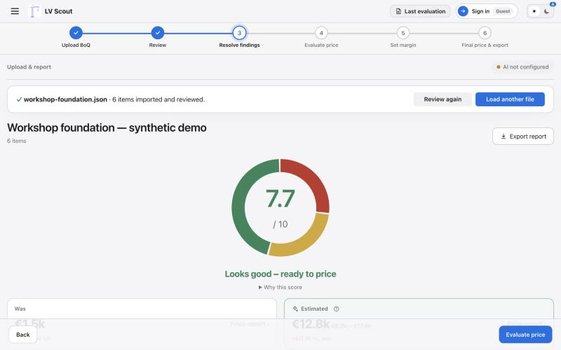
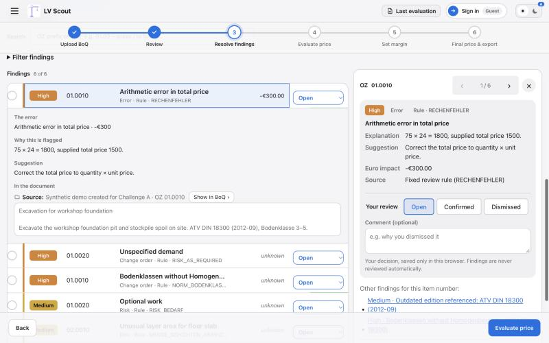
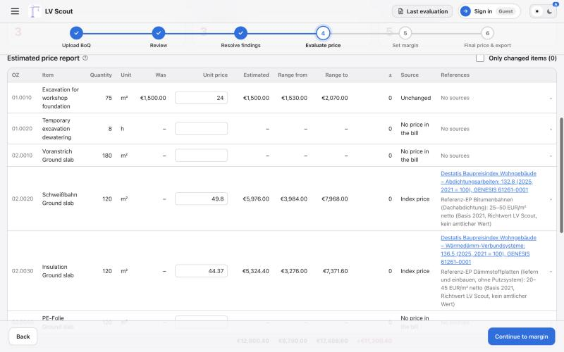
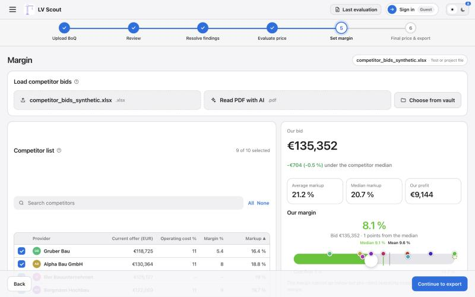
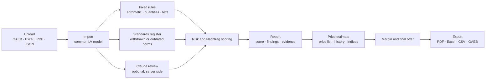

# LV Scout: AI review and pricing assistant for bills of quantities

**TUM.ai Construction Hackathon 2026 · Challenge A**

LV Scout reviews a construction bill of quantities (German *Leistungsverzeichnis*, LV) before a contractor prices and submits a bid. Upload the LV as GAEB, Excel, PDF or JSON. LV Scout extracts every item, finds errors and risks, explains each finding with its item number (OZ) and evidence, estimates prices, and walks you to a final offer and export.



## Why it matters

An estimator often has a few days for a tender with hundreds or thousands of items. A missed error costs money after the job is won; a price set too high loses the job. One project partner described the task like this: the job is not to process 9,000 items, but to find the 100 that matter. LV Scout puts those items first and gives the reason, the source and a next step for each one.

## What it does

| Step | What you get |
| --- | --- |
| 1. Upload | GAEB XML (X83, X84), GAEB 90 (D83, D84, D86), Excel (.xlsx), text PDF or JSON. Optionally a regulation document and a price list. |
| 2. Review | Fixed rules, quantity plausibility, a standards register and an optional Claude review run on every item. Progress is shown live. |
| 3. Resolve findings | A ranked list with severity, rule or model source, an explanation, a suggestion and a link to the exact place in the document. You confirm or dismiss each finding. |
| 4. Evaluate price | Item-by-item estimate from your price list, past projects and public price indices, with a range and its sources. |
| 5. Set margin | Compare against competitor bids and set your margin. Your price never drops below your own costs. |
| 6. Final price and export | Final offer, then export as PDF, Excel, CSV or GAEB (X81–X86). |

<table>
<tr>
<td width="50%"><br><sub>Step 3: every finding names its OZ, rule and source and suggests what to do.</sub></td>
<td width="50%"><br><sub>Step 4: estimated unit prices with range and source, e.g. a public construction price index.</sub></td>
</tr>
<tr>
<td width="50%"><br><sub>Step 5: margin against synthetic competitor bids.</sub></td>
<td width="50%"><br><sub>Step 6: final offer and export to PDF, Excel, CSV or GAEB.</sub></td>
</tr>
</table>

All screenshots use synthetic data only: [`data/demo/workshop-foundation.json`](data/demo/workshop-foundation.json) and [`data/testfaelle/marge/competitor_bids_synthetic.xlsx`](data/testfaelle/marge/competitor_bids_synthetic.xlsx).

## Quick start

Requirements: Python 3.11+ and Node.js 20.9+ with npm. Run from the repository root:

```sh
python tools/dev.py --install
```

This installs the Python and web dependencies and starts both services. Use `python3` if your system has no `python` command.

- App: <http://localhost:3000>
- API health and model status: <http://localhost:8000/health>

Without an API key, LV Scout runs **fully offline**: fixed rules, quantity checks and the bundled standards register still work, and the report marks the model part as a mock. For the live Claude review, standards research and PDF vision fallback, create `.env.local` in the repository root and restart:

```dotenv
LLM_PROVIDER=anthropic
ANTHROPIC_API_KEY=your-key-here
```

Keep keys in `.env.local` or environment variables, never in Git. All other settings, with defaults, are listed in [`.env.example`](.env.example).

## Two-minute demo

1. Open **New evaluation**, choose **Upload files** and select [`data/demo/workshop-foundation.json`](data/demo/workshop-foundation.json), a six-item synthetic LV. Click **Evaluate**, then **Continue to findings**.
2. **OZ 01.0010**: the arithmetic rule shows 75 m³ × €24/m³ = €1,800, while the LV states €1,500 (−€300). The same item cites an outdated edition of ATV DIN 18300 (2012-09) and legacy soil classes instead of homogeneous zones.
3. **OZ 02.0010**: the primer covers 180 m², while the three related slab layers each cover 120 m². Ask whether the primer covers an extra area.
4. **OZ 01.0020**: the dewatering is "as required". The risk finding turns this into a question for the client: who instructs pumping, how is it measured and how is it paid?
5. Click **Evaluate price** to see the estimate per item, then **Continue to margin** and **Continue to export** for the final offer and downloads.

## How it works



| Layer | Technology | Where |
| --- | --- | --- |
| Web UI | Next.js (React, TypeScript) | [`web/`](web/) |
| API | FastAPI (Python) | [`api/app/`](api/app/) |
| Import | GAEB XML and GAEB 90, Excel, PDF with optional Claude vision fallback for parser gaps | [`api/app/lv/`](api/app/lv/) |
| Review rules and standards | Fixed rules, quantity plausibility, standards register | [`api/app/pruefung/`](api/app/pruefung/) |
| Risk and Nachtrag | Risk scoring per item type (optional, hourly, lump-sum, "as required") | [`api/app/risiko/`](api/app/risiko/) |
| Model access | One server-side client for Claude and other providers; never called from the browser | [`api/app/ai/llm.py`](api/app/ai/llm.py) |
| Price and history data | DuckDB price database, history of past projects | [`db/`](db/) |

Design principles:

- **Every finding cites its source.** Each finding names its OZ and says whether a fixed rule or the model produced it. Nothing invents items, prices or standards.
- **No number without a basis.** Unknown prices stay empty instead of guessed. Estimates show a range and where it came from.
- **People decide.** Findings are never confirmed automatically; the estimator confirms or dismisses each one.

## Measured results

One reproducible run against a manually reviewed benchmark LV (structural works for a single-family house, 40-page PDF, 25 documented findings), in offline mode with no model:

| Metric | Result |
| --- | --- |
| Documented findings found by fixed rules alone | **16 of 25** |
| Findings the reviewer marked as rule-findable, found | **12 of 13** |
| Findings matching nothing on the reviewer's list | **1 of 34** |
| Items imported from the PDF | 100 |
| Import plus review time (median of 3 runs) | 2.70 s |

Most of the nine misses are marked in the reviewer's list as model work, such as preamble clauses or missing positions, so the offline run cannot find them. This is one document, so it says nothing about other LVs, and no manual review was timed, so we claim no time saving. Method, definitions and the full table: [`data/vergleich.md`](data/vergleich.md). Reproduce with `python tools/messe_demo.py`.

## Tests

| Suite | Command | Result on 22 Nov 2026 |
| --- | --- | --- |
| API | `cd api && python -m pytest -q` | 925 passed, 1 skipped |
| Web unit tests | `cd web && npm test` | 225 passed |
| Web build | `cd web && npm run build` | passes |
| Team tooling | `python -m unittest discover -s tests -v` | passes |

All tests run offline and free, with the model mocked.

## Data and privacy

- The partner dataset is confidential. It stays in this private repository and is never published. Demos, screenshots and fixtures use synthetic data only.
- Model calls run only on the server. Without a key, no data leaves the machine. With a key, an LV goes only to the configured model provider.

## Repository map

| Path | Content |
| --- | --- |
| [`web/`](web/) | Next.js app: upload, report, prices, margin, export |
| [`api/`](api/) | FastAPI backend: import, review, risk, pricing, model access |
| [`db/`](db/) | Price database and history storage |
| [`data/demo/`](data/demo/) | Synthetic demo LV for the jury |
| [`data/vergleich.md`](data/vergleich.md) | Benchmark measurement |
| [`docs/`](docs/) | [Challenge brief](docs/case.md), [domain guide](docs/domaene.md), [architecture](docs/architektur.md), [demo guide](docs/demo.md) |
| [`pitch/`](pitch/) | Three-minute pitch and Q&A |
| [`tools/`](tools/) | Launcher, measurement and team tooling |

## Team

Built in one weekend by five people for TUM.ai Construction Hackathon 2026, Challenge A. Team workflow: [AGENTS.md](AGENTS.md) and the [team board](https://github.com/f89pkdtkhw-lab/tum-ai-boq-assistant/issues/1).
