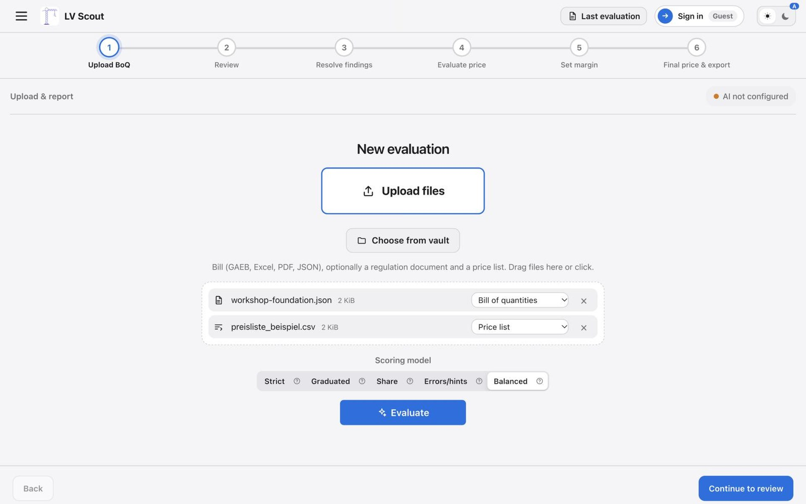
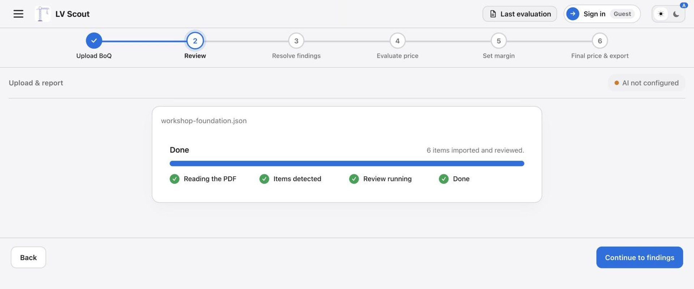
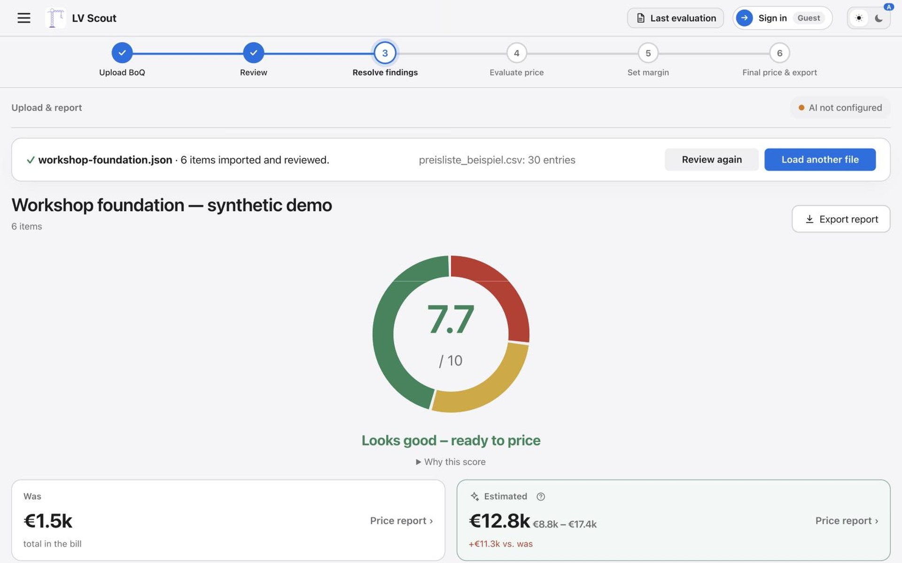
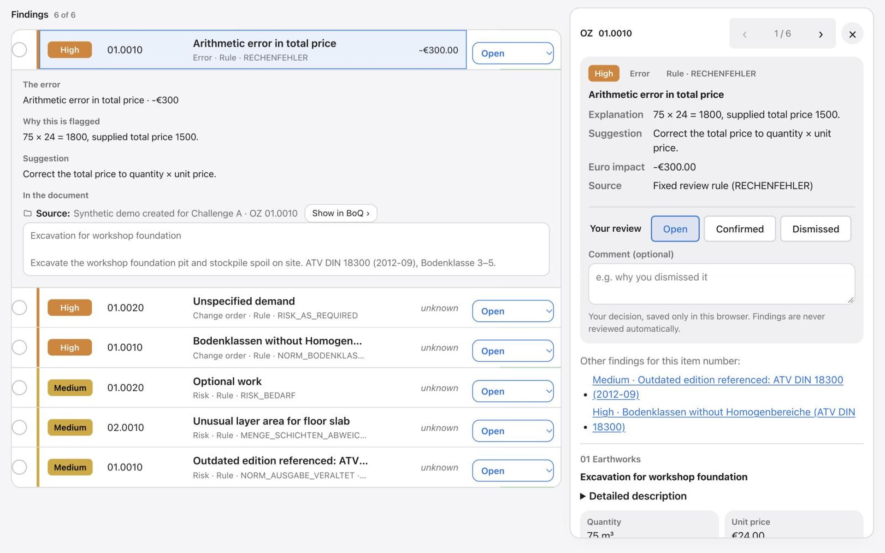
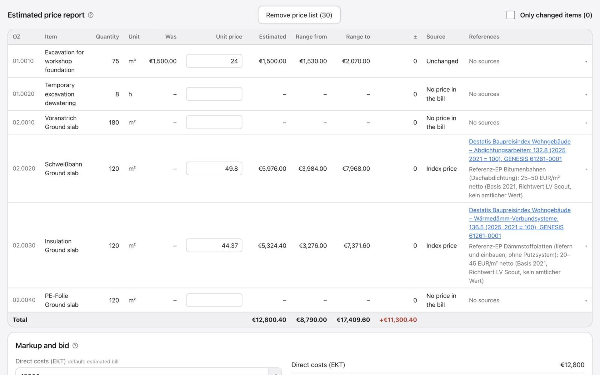
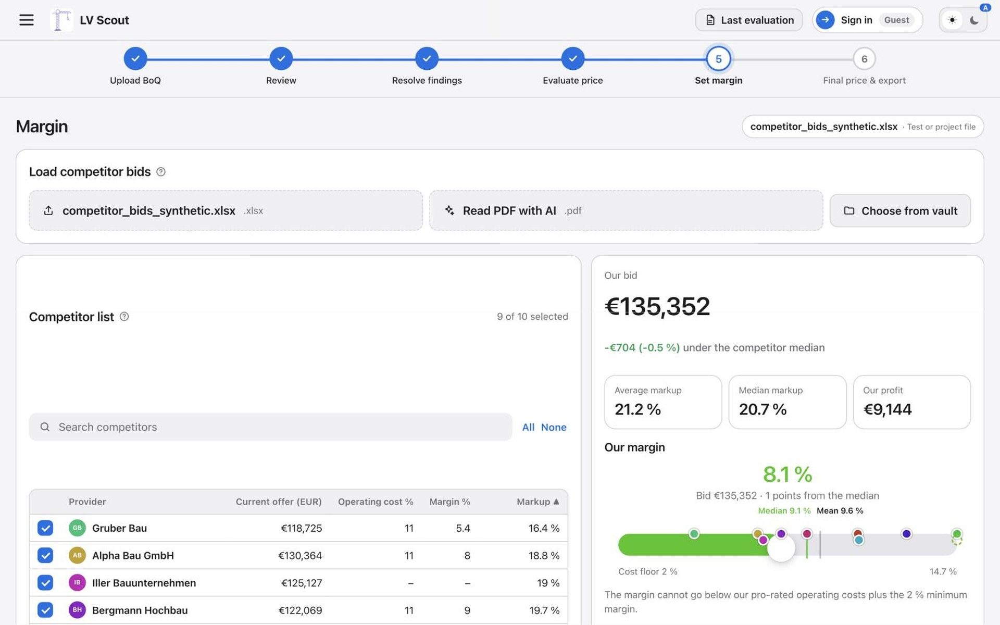
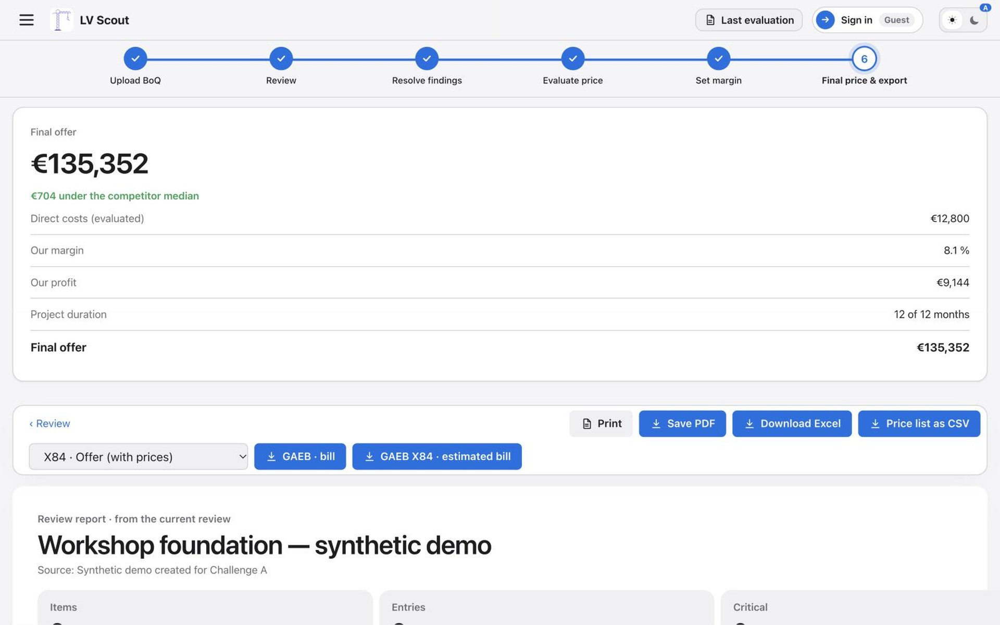
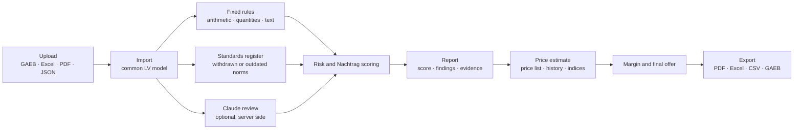

# LV Scout: AI review and pricing assistant for bills of quantities

**TUM.ai Construction Hackathon 2026 · Challenge A**

LV Scout reviews a construction bill of quantities (German *Leistungsverzeichnis*, LV) before a contractor prices and submits a bid. Upload the LV as GAEB, Excel, PDF or JSON. LV Scout extracts every item, finds errors and risks, explains each finding with its item number (OZ) and evidence, estimates prices, and walks you to a final offer and export.

## Why it matters

An estimator often has a few days for a tender with hundreds or thousands of items. A missed error costs money after the job is won; a price set too high loses the job. One project partner described the task like this: the job is not to process 9,000 items, but to find the 100 that matter. LV Scout puts those items first and gives the reason, the source and a next step for each one.

## What it does

Upload a bill → review → resolve findings → price → margin → final offer and export. The [walkthrough](#walkthrough-from-bill-to-bid-in-six-steps) shows every step with a screenshot.

## Quick start

Requirements: Python 3.11+ and Node.js 20.9+ with npm. Run from the repository root:

```sh
python tools/dev.py --install
```

This installs the Python and web dependencies and starts both services. Use `python3` if your system has no `python` command.

- App: <http://localhost:3000>
- API health and model status: <http://localhost:8000/health>

Without an API key, LV Scout runs **fully offline**: fixed rules, quantity checks and the bundled standards register still work, and the report marks the model part as a mock. For the live Claude review, standards research and PDF vision fallback, create `.env.local` in the repository root and restart:

```dotenv
LLM_PROVIDER=anthropic
ANTHROPIC_API_KEY=your-key-here
```

Keep keys in `.env.local` or environment variables, never in Git. All other settings, with defaults, are listed in [`.env.example`](.env.example).

## Walkthrough: from bill to bid in six steps

The app guides you through six steps; the bar at the top always shows where you are. The screenshots below follow one run on synthetic data from start to finish, so you can repeat it yourself after the [quick start](#quick-start): the six-item LV [`data/demo/workshop-foundation.json`](data/demo/workshop-foundation.json), the price list [`data/preisliste_beispiel.csv`](data/preisliste_beispiel.csv) and the competitor bids [`data/testfaelle/marge/competitor_bids_synthetic.xlsx`](data/testfaelle/marge/competitor_bids_synthetic.xlsx). No real partner data is shown.

### Step 1 · Upload the bill

Open **New evaluation** and click **Upload files**. Add the bill of quantities and, optionally, a price list and a regulation document. LV Scout guesses each file's role (*Bill of quantities*, *Price list*, *Regulation document*); you can change it in the dropdown. Click **Evaluate**.

Supported bill formats: GAEB XML (X83, X84), GAEB 90 (D83, D84, D86), Excel (.xlsx), text PDF and JSON.



### Step 2 · Review runs

LV Scout reads the file, detects the items and runs the review: fixed rules, quantity checks, the standards register and, with an API key, the Claude review. Progress is shown live. When it says **Done**, click **Continue to findings**.



### Step 3 · Resolve findings

First you see the overall result: a score out of 10 with the reasons behind it (**Why this score**), the bill total (*Was*) and the estimated total.



Click **Show details** for the ranked list. Each finding names its item number (OZ), severity, whether a fixed rule or the model found it, an explanation, a suggestion and where it is in the document. Mark each one **Confirmed** or **Dismissed**. In the demo:

- **OZ 01.0010**: the arithmetic rule shows 75 m³ × €24/m³ = €1,800, while the LV states €1,500 (−€300). The same item cites an outdated edition of ATV DIN 18300 (2012-09) and legacy soil classes instead of homogeneous zones.
- **OZ 01.0020**: dewatering "as required", flagged as a likely Nachtrag (change order) with a question for the client.
- **OZ 02.0010**: the primer covers 180 m², while the related slab layers cover 120 m².



### Step 4 · Evaluate price

Click **Evaluate price**. Every item gets an estimated unit price with a range and its source: your price list, past projects or, for raw-material work, a public construction price index (Destatis). Items without any basis stay empty instead of guessed. You can overwrite any unit price.



### Step 5 · Set margin

Click **Continue to margin** and load competitor bids (Excel, or a PDF read by AI). LV Scout shows where your bid sits against the competitors and lets you set your margin with a slider. Your price never drops below your own costs.



### Step 6 · Final price and export

Click **Continue to export** for the final offer, then download it as PDF, Excel, a CSV price list or GAEB (X81–X86, including X84 with prices).



> The competitor sheet in step 5 is a generic synthetic file for a larger project, so the final offer in step 6 is much higher than the six-item demo bill. With your own bids the numbers line up.

## How it works



| Layer | Technology | Where |
| --- | --- | --- |
| Web UI | Next.js (React, TypeScript) | [`web/`](web/) |
| API | FastAPI (Python) | [`api/app/`](api/app/) |
| Import | GAEB XML and GAEB 90, Excel, PDF with optional Claude vision fallback for parser gaps | [`api/app/lv/`](api/app/lv/) |
| Review rules and standards | Fixed rules, quantity plausibility, standards register | [`api/app/pruefung/`](api/app/pruefung/) |
| Risk and Nachtrag | Risk scoring per item type (optional, hourly, lump-sum, "as required") | [`api/app/risiko/`](api/app/risiko/) |
| Model access | One server-side client for Claude and other providers; never called from the browser | [`api/app/ai/llm.py`](api/app/ai/llm.py) |
| Price and history data | DuckDB price database, history of past projects | [`db/`](db/) |

Design principles:

- **Every finding cites its source.** Each finding names its OZ and says whether a fixed rule or the model produced it. Nothing invents items, prices or standards.
- **No number without a basis.** Unknown prices stay empty instead of guessed. Estimates show a range and where it came from.
- **People decide.** Findings are never confirmed automatically; the estimator confirms or dismisses each one.

## Measured results

One reproducible run against a manually reviewed benchmark LV (structural works for a single-family house, 40-page PDF, 25 documented findings), in offline mode with no model:

| Metric | Result |
| --- | --- |
| Documented findings found by fixed rules alone | **16 of 25** |
| Findings the reviewer marked as rule-findable, found | **12 of 13** |
| Findings matching nothing on the reviewer's list | **1 of 34** |
| Items imported from the PDF | 100 |
| Import plus review time (median of 3 runs) | 2.70 s |

Most of the nine misses are marked in the reviewer's list as model work, such as preamble clauses or missing positions, so the offline run cannot find them. This is one document, so it says nothing about other LVs, and no manual review was timed, so we claim no time saving. Method, definitions and the full table: [`data/vergleich.md`](data/vergleich.md). Reproduce with `python tools/messe_demo.py`.

## Tests

| Suite | Command | Result on 22 Nov 2026 |
| --- | --- | --- |
| API | `cd api && python -m pytest -q` | 925 passed, 1 skipped |
| Web unit tests | `cd web && npm test` | 225 passed |
| Web build | `cd web && npm run build` | passes |
| Team tooling | `python -m unittest discover -s tests -v` | passes |

All tests run offline and free, with the model mocked.

## Data and privacy

- The partner dataset is confidential. It stays in this private repository and is never published. Demos, screenshots and fixtures use synthetic data only.
- Model calls run only on the server. Without a key, no data leaves the machine. With a key, an LV goes only to the configured model provider.

## Repository map

| Path | Content |
| --- | --- |
| [`web/`](web/) | Next.js app: upload, report, prices, margin, export |
| [`api/`](api/) | FastAPI backend: import, review, risk, pricing, model access |
| [`db/`](db/) | Price database and history storage |
| [`data/demo/`](data/demo/) | Synthetic demo LV for the jury |
| [`data/vergleich.md`](data/vergleich.md) | Benchmark measurement |
| [`docs/`](docs/) | [Challenge brief](docs/case.md), [domain guide](docs/domaene.md), [architecture](docs/architektur.md), [demo guide](docs/demo.md) |
| [`pitch/`](pitch/) | Three-minute pitch and Q&A |
| [`tools/`](tools/) | Launcher, measurement and team tooling |

## Team

Built in one weekend by five people for TUM.ai Construction Hackathon 2026, Challenge A. Team workflow: [AGENTS.md](AGENTS.md) and the [team board](https://github.com/f89pkdtkhw-lab/tum-ai-boq-assistant/issues/1).
