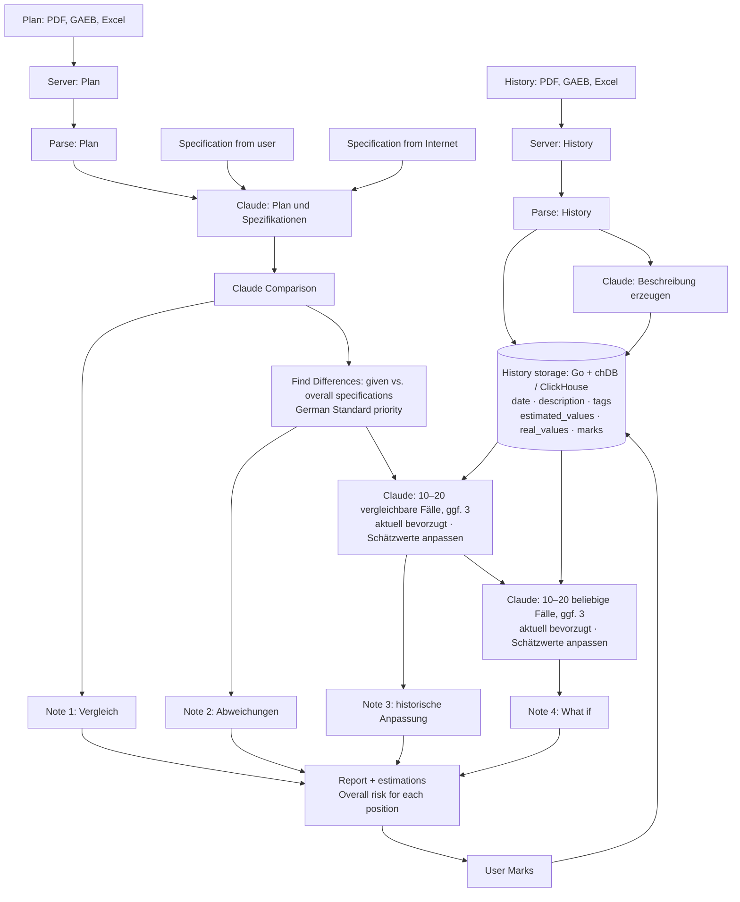

# Architektur: LV-Prüfung und spätere Lernschleife

Quelle: vom Lead geteiltes Architekturdiagramm, hier nach dessen Abschrift dokumentiert (20.11.2026). Es beschreibt das Zielbild; die Kästen sind keine Aussage über bereits implementierte Funktionen. Der aktuelle Vertrag steht in [schnittstelle.md](schnittstelle.md).

**Verbindliche Priorität: Parsing → feste Fehlerprüfung → verständlicher Bericht.** Zuerst P1 #6, #7, #8 und #12 fertigstellen. LLM bleibt im Offline-Mock; „Claude“ bezeichnet im Entwurf einen späteren serverseitigen Modellschritt, keine Freigabe für Live-Aufrufe. Neue Historien-, Spezifikations- und Szenariofunktionen kommen nach P1. Unbekannte Preise bleiben `null`, Schätzungen brauchen die Freigabe des Kalkulators.

## Ablauf als Text

1. **History (PDF, GAEB, Excel)** → Server → Parse. Ein Claude-Schritt neben Parse erzeugt eine als KI-generiert gekennzeichnete Beschreibung. Die historischen Daten fließen in **History storage (chDB)** mit den Feldern **date**, **description**, **tags**, **estimated_values**, **real_values**, **marks**. chDB ist die gewünschte Speicheroption des Entwurfs, noch keine installierte Abhängigkeit oder fertige Datenbank.
2. **Plan (PDF, GAEB, Excel)** → Server → Parse → Claude. In diesen Modellschritt fließen **Specification from user** und **Specification from Internet** als nachvollziehbar belegte Quellen ein.
3. Claude → **Claude Comparison** → **Note 1**: Ergebnis des ersten Vergleichs.
4. Claude Comparison → **Find Differences between given and overall specifications with German Standard priority** → **Note 2**. Deutsche Standards erhalten im Zielbild Priorität; Anwendbarkeit und Quelle müssen geprüft sein. Unbelegte Modellbehauptungen sind keine Normprüfung.
5. Danach: **Claude take history from storage 10–20 cases (or 3), recently better the same cases. Adjust estimated values** → **Note 3**. Möglichst aktuelle, vergleichbare Fälle wählen; tatsächliche Fallzahl und Auswahlbegründung nennen.
6. Danach: **Claude take history from storage 10–20 any cases (or 3), recently better. Adjust estimated values** → **Note 4 What if**. Ein breiterer aktueller Fallpool liefert ein getrenntes hypothetisches Szenario mit expliziten Annahmen.
7. **Note 1–4** → **Report + estimations + Overall risk for each position** → **User Marks** → Rückkopplung in History storage. Nutzerbewertungen, Sollwerte, Ist-Beobachtungen und Modellschätzungen getrennt halten; Original-OZ und Herkunft erhalten.

## Zielbild als Mermaid

## Abdeckung durch bestehende Issues #6–#17

Die Tabelle ordnet geplante Arbeit zu; sie meldet keine Fertigstellung. Server und gemeinsames LV-/Finding-Modell sind seit dem Kickoff vorhanden. Eine separate History-Route und Notes 1–4 sind darin nicht definiert.

| Kasten im Diagramm | Bestehende Issues | Abdeckung und verbleibende Lücke |
| --- | --- | --- |
| History-Eingang PDF/GAEB/Excel | #6 GAEB, #9 Excel, #10 PDF | Parser wiederverwendbar; History-Aufnahme fehlt. |
| Server (History und Plan) | #6/#9/#10, #12 Upload, #16 Demo | Bestehender Import-/Prüfserver; kein eigener History-Ablauf. |
| Parse (History und Plan) | #6/#9/#10 | Strukturierte Originalpositionen; keine Soll-/Ist-Zuordnung zur Historie. |
| Claude-Beschreibung und Tags neben History-Parse | #23, #16 Modellzugriff | Mock-Metadaten-API bei @f89pkdtkhw-lab. |
| History storage Go/chDB mit Beschreibung, Tags, Soll/Ist und Marks | #18 | Speicher und HTTP-API bei @Anatomik5. |
| Plan-Eingang PDF/GAEB/Excel | #6/#9/#10, #12 | Upload und Import, ohne zusätzliche Spezifikationseingabe. |
| Specification from user | keines | Quellenvertrag #19; UI-API #24. |
| Specification from Internet | keines | Neu: verifizierbarer Quellenvertrag #19; kein automatischer Internetabruf. |
| Claude für Plan und Spezifikationen | #13/#16 teilweise | Mock-Infrastruktur vorhanden/geplant; Spezifikationskontext fehlt. |
| Claude Comparison | #7 feste Fehler, #11 Mengen, #13 Mock | Teilweise fachliche Vergleiche; kein allgemeiner Spezifikationsvergleich. |
| Note 1 | #7/#11/#13, Anzeige #8/#12 | Findings statt eigenem Note-Vertrag; Spezifikationsbezug #19. |
| Differences / German Standard priority | #7/#11/#13 teilweise | Plausibilität und belegte Mock-Normhinweise; keine allgemeine oder rechtlich verbindliche Normprüfung. Quellenpriorität #19 fehlt. |
| Note 2 | #8/#12/#15 Darstellung/Export | Spezifikationsabweichung #19, Schritt-API #23 und Anzeige #24. |
| Historie: 10–20 vergleichbare Fälle, ggf. 3; Schätzanpassung | keines | Neu: Auswahl, Evidenz und Schätzvertrag #20 nach #18. |
| Note 3 | keines | Neu: belegte historische Anpassung #20. |
| Historie: 10–20 beliebige Fälle, ggf. 3; What-if | keines | Neu: getrenntes hypothetisches Szenario #20. |
| Note 4 What if | keines | Neu: Annahmen, Unsicherheit und Fallbezug #20. |
| Report + estimations + overall risk je Position | #8 Bericht, #12 Upload→Bericht, #15 Export; #14 Risiko | Bericht und regelbasierte Risiken abgedeckt; historische Preise/Schätzungen und Notes-Zusammenführung fehlen. |
| User Marks → History storage | #18 | Speicherung/HTTP bei @Anatomik5; UI und UI-API separat bei @Zukipany. |
| Vorführbarer Gesamtweg und Pitch | #16 Demo/Messung, #17 Pitch | Prüft/erklärt den tatsächlich funktionierenden Kern; kein Ersatz für fehlende Kästen. |

## Zuständigkeiten und API-Grenzen

@Anatomik5 besitzt Parser und den Go-History-Service in `history/` (ClickHouse via chDB) samt HTTP-API. Ein zusätzlicher API-Orchestrator ist optional und wird erst nach gemeinsamer Vertragsabstimmung beauftragt. Die konkrete Go/chDB-Anbindung wird in #18 dokumentiert und offline geprüft; hier wird keine Abhängigkeit installiert.

@Zukipany besitzt `web/` und die UI-API in `web/app/api/`: Berichte pro Vergleichsschritt, History-Ansicht sowie Eingabe von Ist-Werten, Kommentaren und Marks. Die UI-API konsumiert die History- und Vergleichs-API; Modellaufrufe laufen weiterhin ausschließlich serverseitig über `api/app/ai/llm.py`.

Die Claude/AI-Schicht wird ohne überlappende Module geteilt: @Bartuan3600 besitzt `api/app/pruefung/` (Vergleich, belegte Abweichungen von deutschen Standards, Notes 1/2); @Secret-Sebi besitzt `api/app/risiko/` und `api/app/kalkulation/` (Schätzungen, historische Anpassung, Risiko, Notes 3/4); @f89pkdtkhw-lab besitzt `api/app/ai/` (Schritt-API, Zusammenführung des Berichts, Beschreibung und Tag-Erzeugung) und behält Integration/Deploy/Demo. Fachlogik bleibt in den jeweiligen Modulen.

Die folgenden neuen Routen sind **Vertragsvorschläge**, keine vorhandenen Endpunkte. Implementierung erst nach den genannten Blockern und vorab mit `@all` angekündigtem Vertrag:

| API | Besitzer | Vorgeschlagener Vertrag |
| --- | --- | --- |
| History-HTTP-API | @Anatomik5 | `POST /history/records` aufnehmen; `GET /history/records?tags=bridge&limit=20` aktuelle vergleichbare Fälle suchen; `GET /history/records/{case_id}` lesen; `PATCH /history/records/{case_id}` Ist-Werte/Kommentare/Marks aktualisieren. Filter, Reihenfolge und Fehler werden in #18 festgelegt. |
| Claude-Vergleich je Schritt | @f89pkdtkhw-lab, Fachmodule @Bartuan3600 / @Secret-Sebi | `POST /api/comparison/steps`: `step`, `lv`, `specifications`, `history_records`, `previous_notes` → `step`, `status`, `notes`, `findings`, `evidence`, `errors`. Notes behalten Quellen, Original-OZ und gegebenenfalls Fall-IDs; Fehler sind schrittbezogen sichtbar. |
| UI-API | @Zukipany | `web/app/api/`: Schrittberichte und History lesen, Nutzereingaben validieren, Beschreibung/Tags serverseitig erzeugen lassen und anschließend per History-API speichern; Backendfehler verständlich anzeigen. Genaue UI-Routen werden im UI-Auftrag festgelegt. |

Bestehende deutsche Bezeichner, `modelle.py`, `pruefe_regeln` und vorhandene Routen bleiben bestehen. Neuer Code, Bezeichner, Kommentare, Commits und PR-Titel sind Englisch; eine spätere Umbenennung erfordert einen separaten, vorher mit `@all` angekündigten PR. Die neuen englischen Felder werden an der API-Grenze abgebildet, ohne das vorhandene LV-/Finding-Modell umzubenennen.

## History-Datensatz: Vorschlag zur Bestätigung durch @Anatomik5

**Feldtypen und HTTP-Details sind ein Vorschlag und müssen von @Anatomik5 in #18 bestätigt werden.** Die fachlichen Inhalte stammen aus der Rollenabsprache. Beschreibung und Tags erzeugt die AI-Schicht aus dem bereitgestellten Fall; Ist-Werte, Kommentare, Marks und die Erklärung, was passiert ist und warum, kommen vom Nutzer. Die Generierung darf fehlende Nutzerdaten nicht erfinden.

| Feld | Vorgeschlagener JSON-Typ | Bedeutung |
| --- | --- | --- |
| `case_id` | string | Stabile Fallreferenz für Lesen, Suche und Änderungen. |
| `date` | string (ISO-8601-Datum) | Falldatum für Aktualität und Sortierung. |
| `description` | string | Als AI-generiert gekennzeichnete Fallbeschreibung; im Standardlauf Mock. |
| `tags` | array of string | AI-generierte Suchbegriffe, z. B. `bridge`; aktuelle ähnliche Fälle zuerst über Tags finden, dann anhand der Beschreibung prüfen. |
| `estimated_values` | array of measurement | Schätz-/Sollwerte, getrennt von Beobachtungen. |
| `real_values` | array of measurement | Vom Nutzer eingetragene Ist-Werte; unbekannt bleibt `null`. |
| `comments` | array of string | Optionale Nutzerkommentare. |
| `marks` | array of object | Nutzerurteile mit `oz`, `title_path`, `status`, optional `what_happened` und `reason`; was geschah und warum darf fehlen. |

Vorgeschlagenes `measurement`: `{oz, title_path, metric, value, unit}` mit `value: number | null`; Original-OZ und Titelpfad erhalten Mehrdeutigkeiten. Beschreibungen/Tags sind keine Nutzermarks. Herkunft (Nutzer, Regel, Modell/Mock), Fallbezug und Kennzeichnung als Schätzung müssen beim Speichern und Lesen erhalten bleiben; das genaue Metadatenformat legt #18 fest. Keine vertraulichen Roh-LVs an zusätzliche Dienste senden.

Synthetisches Beispiel: Fall `H1`, Datum `2026-11-20`, Beschreibung `Mock: bridge repair`, Tags `["bridge"]`, Schätzung `100 h`, Ist-Wert `120 h`, OZ `01.001`, Titelpfad `["Bridge"]`, Nutzer-Mark `confirmed`, `what_happened: extra work`, `reason: user-reported access restriction`. Erneutes Lesen erhält diese getrennten Angaben; eine fehlende Erklärung bleibt fehlend. Vergleichbare Fälle werden nach Tags und Aktualität gesucht und anschließend anhand der Beschreibung geprüft.

## Folgeaufträge nach P1

Ziel der nächsten Demo bleibt Upload → Fehlerprüfung → verständlicher Bericht. Die folgende Erweiterung folgt erst nach P1; LLM bleibt offline im Mock. Kein Auftrag startet mit offenen Blockern.

| Issue / Ergebnis | Besitzer | Bereich | Blockiert durch | Werkzeug |
| --- | --- | --- | --- | --- |
| #18 Go/chDB-History, HTTP-API und User Marks | @Anatomik5 | history/, docs/historie.md, data/architektur/historie.json | #6, #7, #12 | Codex, modell:schwer |
| #19 Quellenpriorität, Spezifikationen, Notes 1/2 | @Bartuan3600 | docs/spezifikationen.md, data/architektur/spezifikationen.json | #7, #12, #13 | Codex, modell:schwer |
| #20 Historische Schätzanpassung, Notes 3/4 | @Secret-Sebi | docs/schaetzszenarien.md, data/architektur/schaetzszenarien.json | #18, #19, #14 | Codex, modell:schwer |

| #23 Vergleichsschritt-API, Beschreibung und Tags | @f89pkdtkhw-lab | api/app/ai/step_api.py, history_metadata.py, eigene Tests; main.py nur Router-Mount | #18, #19, #20, #13, #16 | Codex, modell:schwer |
| #24 UI-API, Schrittberichte und History-Eingabe | @Zukipany | web/app/history/, web/components/history/, web/app/api/history/, web/app/api/comparison/, eigene API-Adapter | #18, #23, #12 | Claude, modell:ui |

#24 bleibt bis zur Annahme der Repo-Einladung technisch unzugewiesen; fachlicher Besitzer ist @Zukipany. Alle neuen Aufträge sind blockiert und ohne `agent-bereit`; keine Übernahme bestehender Parser-, Prüf- oder UI-Dateien. Die frühere Ankündigung `api/app/historie/` wird durch `history/` unter @Anatomik5 ersetzt.
