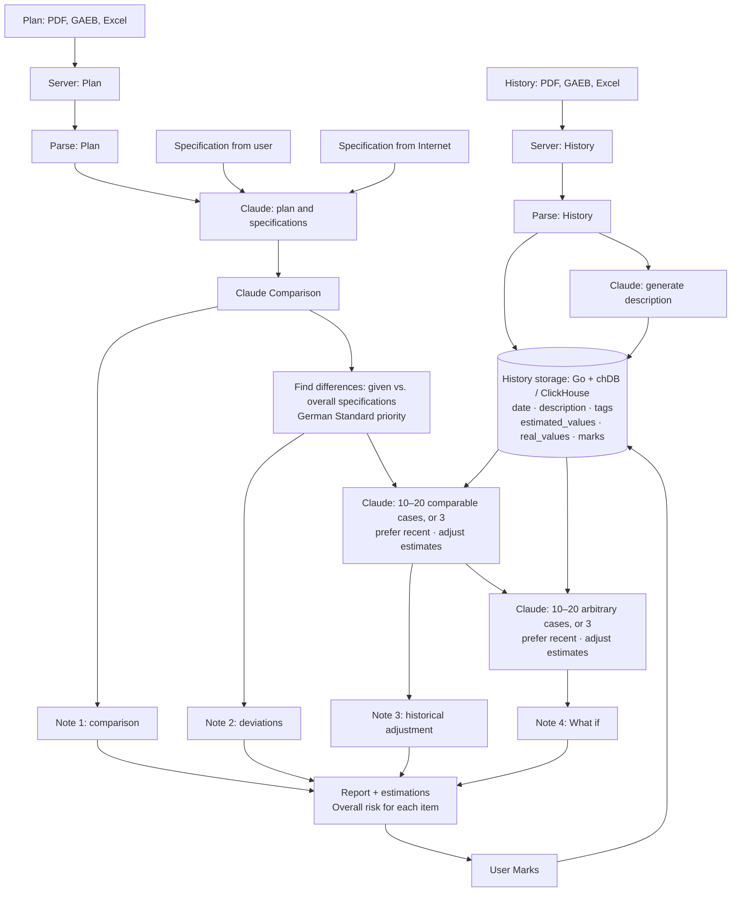

# Architecture: LV review and later learning loop

Source: architecture diagram shared by the lead, documented from its transcription (20 November 2026). It describes the target design; boxes do not claim implemented features. Current contract: [schnittstelle.md](schnittstelle.md).

**Binding priority: parsing → fixed error detection → clear report.** Complete P1 #6, #7, #8 and #12 first. LLM stays offline mock; “Claude” in the draft means a later server-side model step, not permission for live calls. History, specification and scenario features follow P1. Unknown prices remain `null`; estimates require estimator approval.

## Flow in words

1. **History (PDF, GAEB, Excel)** → server → parse. A Claude step beside parsing generates a description marked as AI-generated. Historical data flows into **history storage (chDB)** with **date**, **description**, **tags**, **estimated_values**, **real_values**, **marks**. chDB is the proposed storage option, not an installed dependency or finished database.
2. **Plan (PDF, GAEB, Excel)** → server → parse → Claude. **Specification from user** and **Specification from Internet** enter this model step as traceable, evidenced sources.
3. Claude → **Claude Comparison** → **Note 1**: first comparison result.
4. Claude Comparison → **Find differences between given and overall specifications with German Standard priority** → **Note 2**. The target design prioritizes German standards; applicability and source must be verified. Unsupported model claims are not standards compliance checks.
5. Next: **Claude retrieves 10–20 comparable historical cases (or 3), preferring recent ones, and adjusts estimated values** → **Note 3**. State actual case count and selection rationale.
6. Next: **Claude retrieves 10–20 arbitrary historical cases (or 3), preferring recent ones, and adjusts estimated values** → **Note 4 What if**. A broader recent pool produces a separate hypothetical scenario with explicit assumptions.
7. **Notes 1–4** → **Report + estimations + overall risk per item** → **User Marks** → feedback into history storage. Keep user assessments, planned values, actual observations and model estimates separate; preserve original OZ and provenance.

## Target design in Mermaid

## Coverage by existing issues #6–#17

This table maps planned work, not completion. The server and shared LV/finding model exist since kickoff. They do not define a separate history route or Notes 1–4.

| Diagram box | Existing issues | Coverage and remaining gap |
| --- | --- | --- |
| History PDF/GAEB/Excel input | #6 GAEB, #9 Excel, #10 PDF | Reusable parsers; history ingestion missing. |
| Server (history and plan) | #6/#9/#10, #12 upload, #16 demo | Existing import/review server; no dedicated history flow. |
| Parse (history and plan) | #6/#9/#10 | Structured original items; no planned/actual history mapping. |
| Claude description and tags beside history parsing | #23, #16 model access | Mock metadata API with @f89pkdtkhw-lab. |
| Go/chDB history storage with description, tags, planned/actual values and marks | #18 | Storage and HTTP API with @Anatomik5. |
| Plan PDF/GAEB/Excel input | #6/#9/#10, #12 | Upload and import, without additional specification input. |
| Specification from user | None | Source contract #19; UI API #24. |
| Specification from Internet | None | New: verifiable source contract #19; no automatic internet retrieval. |
| Claude for plan and specifications | #13/#16 partially | Mock infrastructure exists/planned; specification context missing. |
| Claude Comparison | #7 fixed errors, #11 quantities, #13 mock | Partial domain comparisons; no general specification comparison. |
| Note 1 | #7/#11/#13, display #8/#12 | Findings instead of a dedicated note contract; specification links #19. |
| Differences / German Standard priority | #7/#11/#13 partially | Plausibility and evidenced mock standards hints; no general or legally binding compliance check. Source priority #19 missing. |
| Note 2 | #8/#12/#15 display/export | Specification deviations #19, step API #23, display #24. |
| History: 10–20 comparable cases, or 3; estimate adjustment | None | New: selection, evidence and estimation contract #20 after #18. |
| Note 3 | None | New: evidenced historical adjustment #20. |
| History: 10–20 arbitrary cases, or 3; what-if | None | New: separate hypothetical scenario #20. |
| Note 4 What if | None | New: assumptions, uncertainty and case links #20. |
| Report + estimations + overall risk per item | #8 report, #12 upload→report, #15 export; #14 risk | Report and rule-based risks covered; historical prices/estimates and note coordination missing. |
| User Marks → history storage | #18 | Storage/HTTP with @Anatomik5; UI and UI API separately with @Zukipany. |
| Demonstrable complete flow and pitch | #16 demo/evaluation, #17 pitch | Verifies/explains the working core; does not replace missing boxes. |

## Responsibilities and API boundaries

@Anatomik5 owns parsers and the Go history service in `history/` (ClickHouse via chDB), including HTTP API. An additional API orchestrator is optional and assigned only after shared contract agreement. Concrete Go/chDB integration is documented and tested offline in #18; this document installs no dependency.

@Zukipany owns `web/` and the UI API in `web/app/api/`: reports per comparison step, history view, actual values, comments and marks. The UI API consumes history and comparison APIs; model calls remain server-only through `api/app/ai/llm.py`.

The Claude/AI layer has nonoverlapping modules: @Bartuan3600 owns `api/app/pruefung/` (comparison, evidenced deviations from German standards, Notes 1/2); @Secret-Sebi owns `api/app/risiko/` and `api/app/kalkulation/` (estimates, historical adjustment, risk, Notes 3/4); @f89pkdtkhw-lab owns `api/app/ai/` (step API, report coordination, description/tag generation), plus integration/deployment/demo. Domain logic stays in its respective modules.

The following routes are **contract proposals**, not existing endpoints. Implement only after named blockers and a prior `@all` contract announcement:

| API | Owner | Proposed contract |
| --- | --- | --- |
| History HTTP API | @Anatomik5 | `POST /history/records` ingest; `GET /history/records?tags=bridge&limit=20` find recent comparable cases; `GET /history/records/{case_id}` read; `PATCH /history/records/{case_id}` update actual values/comments/marks. Filters, ordering and errors defined in #18. |
| Claude step comparison | @f89pkdtkhw-lab, domain modules @Bartuan3600 / @Secret-Sebi | `POST /api/comparison/steps`: `step`, `lv`, `specifications`, `history_records`, `previous_notes` → `step`, `status`, `notes`, `findings`, `evidence`, `errors`. Notes retain sources, original OZ and case IDs where applicable; errors remain visible per step. |
| UI API | @Zukipany | `web/app/api/`: read step reports/history, validate user input, generate descriptions/tags server-side, then save through history API; display backend errors clearly. Exact UI routes are defined in the UI task. |

Existing German identifiers, `modelle.py`, `pruefe_regeln` and routes remain. All new code, identifiers, comments, documentation, issues, board posts, commits and PRs are English. Renaming requires a separate PR announced with `@all` beforehand. Map new English fields at the API boundary without renaming the existing LV/finding model.

## History record: proposal for confirmation by @Anatomik5

**Field types and HTTP details are proposals requiring @Anatomik5's confirmation in #18.** Domain contents come from the role agreement. The AI layer generates descriptions and tags from the supplied case; users supply actual values, comments, marks, and explanations of what happened and why. Generation must not invent missing user data.

| Field | Proposed JSON type | Meaning |
| --- | --- | --- |
| `case_id` | string | Stable reference for reading, searching and updating. |
| `date` | string (ISO-8601 date) | Case date for recency and sorting. |
| `description` | string | Case description labelled AI-generated; mock in standard runs. |
| `tags` | array of string | AI-generated search terms, e.g. `bridge`; find recent similar cases by tags, then check descriptions. |
| `estimated_values` | array of measurement | Estimated/planned values, separate from observations. |
| `real_values` | array of measurement | User-entered actual values; unknown remains `null`. |
| `comments` | array of string | Optional user comments. |
| `marks` | array of object | User assessments with `oz`, `title_path`, `status`, optional `what_happened` and `reason`; explanations may be absent. |

Proposed `measurement`: `{oz, title_path, metric, value, unit}` with `value: number | null`; original OZ and section path preserve ambiguities. Descriptions/tags are not user marks. Provenance (user, rule, model/mock), case links and estimate labels must survive storage and reading; #18 defines exact metadata. Do not send confidential raw LVs to additional services.

Synthetic example: case `H1`, date `2026-11-20`, description `Mock: bridge repair`, tags `["bridge"]`, estimate `100 h`, actual `120 h`, OZ `01.001`, section path `["Bridge"]`, user mark `confirmed`, `what_happened: extra work`, `reason: user-reported access restriction`. Reading again preserves these separate facts; a missing explanation remains missing. Find comparable cases by tags and recency, then check descriptions.

## Follow-up tasks after P1

The next demo still targets upload → error detection → clear report. Extensions follow P1; LLM stays offline mock. No task starts with open blockers.

| Issue / deliverable | Owner | Scope | Blocked by | Tool |
| --- | --- | --- | --- | --- |
| #18 Go/chDB history, HTTP API and user marks | @Anatomik5 | history/, docs/historie.md, data/architektur/historie.json | #6, #7, #12 | Codex, modell:schwer |
| #19 Source priority, specifications, Notes 1/2 | @Bartuan3600 | docs/spezifikationen.md, data/architektur/spezifikationen.json | #7, #12, #13 | Codex, modell:schwer |
| #20 Historical estimate adjustment, Notes 3/4 | @Secret-Sebi | docs/schaetzszenarien.md, data/architektur/schaetzszenarien.json | #18, #19, #14 | Codex, modell:schwer |
| #23 Comparison-step API, descriptions and tags | @f89pkdtkhw-lab | api/app/ai/step_api.py, history_metadata.py, own tests; main.py only router mount | #18, #19, #20, #13, #16 | Codex, modell:schwer |
| #24 UI API, step reports and history entry | @Zukipany | web/app/history/, web/components/history/, web/app/api/history/, web/app/api/comparison/, own API adapters | #18, #23, #12 | Claude, modell:ui |

#24 remains technically unassigned until the repository invitation is accepted; its domain owner is @Zukipany. All new tasks are blocked without `agent-bereit`; no takeover of existing parser, review or UI files. The earlier `api/app/historie/` announcement is superseded by `history/` under @Anatomik5.
