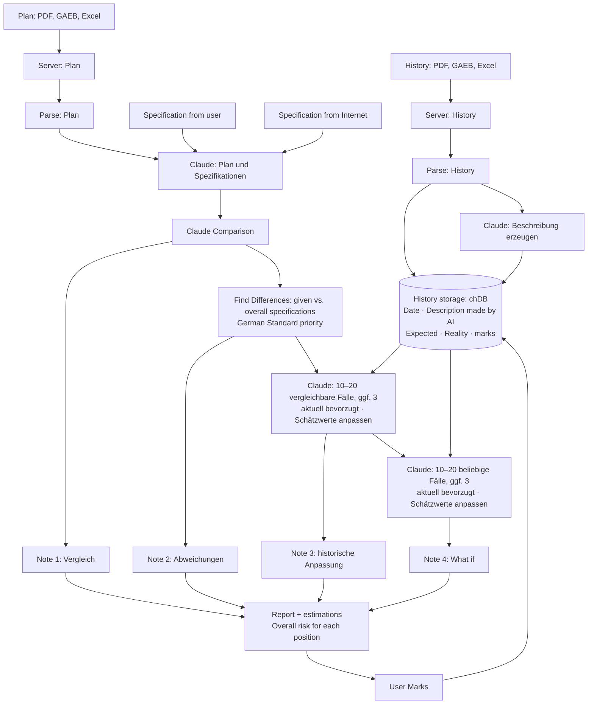

# Architektur: LV-Prüfung und spätere Lernschleife

Quelle: vom Lead geteiltes Architekturdiagramm, hier nach dessen Abschrift dokumentiert (20.11.2026). Es beschreibt das Zielbild; die Kästen sind keine Aussage über bereits implementierte Funktionen. Der aktuelle Vertrag steht in [schnittstelle.md](schnittstelle.md).

**Verbindliche Priorität: Parsing → feste Fehlerprüfung → verständlicher Bericht.** Zuerst P1 #6, #7, #8 und #12 fertigstellen. LLM bleibt im Offline-Mock; „Claude“ bezeichnet im Entwurf einen späteren serverseitigen Modellschritt, keine Freigabe für Live-Aufrufe. Neue Historien-, Spezifikations- und Szenariofunktionen kommen nach P1. Unbekannte Preise bleiben `null`, Schätzungen brauchen die Freigabe des Kalkulators.

## Ablauf als Text

1. **History (PDF, GAEB, Excel)** → Server → Parse. Ein Claude-Schritt neben Parse erzeugt eine als KI-generiert gekennzeichnete Beschreibung. Die historischen Daten fließen in **History storage (chDB)** mit den Feldern **Date**, **Description made by AI**, **Expected**, **Reality**, **marks**. chDB ist die gewünschte Speicheroption des Entwurfs, noch keine installierte Abhängigkeit oder fertige Datenbank.
2. **Plan (PDF, GAEB, Excel)** → Server → Parse → Claude. In diesen Modellschritt fließen **Specification from user** und **Specification from Internet** als nachvollziehbar belegte Quellen ein.
3. Claude → **Claude Comparison** → **Note 1**: Ergebnis des ersten Vergleichs.
4. Claude Comparison → **Find Differences between given and overall specifications with German Standard priority** → **Note 2**. Deutsche Standards erhalten im Zielbild Priorität; Anwendbarkeit und Quelle müssen geprüft sein. Unbelegte Modellbehauptungen sind keine Normprüfung.
5. Danach: **Claude take history from storage 10–20 cases (or 3), recently better the same cases. Adjust estimated values** → **Note 3**. Möglichst aktuelle, vergleichbare Fälle wählen; tatsächliche Fallzahl und Auswahlbegründung nennen.
6. Danach: **Claude take history from storage 10–20 any cases (or 3), recently better. Adjust estimated values** → **Note 4 What if**. Ein breiterer aktueller Fallpool liefert ein getrenntes hypothetisches Szenario mit expliziten Annahmen.
7. **Note 1–4** → **Report + estimations + Overall risk for each position** → **User Marks** → Rückkopplung in History storage. Nutzerbewertungen, Sollwerte, Ist-Beobachtungen und Modellschätzungen getrennt halten; Original-OZ und Herkunft erhalten.

## Zielbild als Mermaid

## Abdeckung durch bestehende Issues #6–#17

Die Tabelle ordnet geplante Arbeit zu; sie meldet keine Fertigstellung. Server und gemeinsames LV-/Finding-Modell sind seit dem Kickoff vorhanden. Eine separate History-Route und Notes 1–4 sind darin nicht definiert.

| Kasten im Diagramm | Bestehende Issues | Abdeckung und verbleibende Lücke |
| --- | --- | --- |
| History-Eingang PDF/GAEB/Excel | #6 GAEB, #9 Excel, #10 PDF | Parser wiederverwendbar; History-Aufnahme fehlt. |
| Server (History und Plan) | #6/#9/#10, #12 Upload, #16 Demo | Bestehender Import-/Prüfserver; kein eigener History-Ablauf. |
| Parse (History und Plan) | #6/#9/#10 | Strukturierte Originalpositionen; keine Soll-/Ist-Zuordnung zur Historie. |
| Claude-Beschreibung neben History-Parse | #13 Mock-Prüfung, #16 Modellzugriff | Keine historische Beschreibung beauftragt. |
| History storage chDB mit fünf Feldern | keines | Neu: Speichervertrag und Datenhaltung, #18. |
| Plan-Eingang PDF/GAEB/Excel | #6/#9/#10, #12 | Upload und Import, ohne zusätzliche Spezifikationseingabe. |
| Specification from user | keines | Neu: Eingabe-/Quellenvertrag #19, spätere UI separat. |
| Specification from Internet | keines | Neu: verifizierbarer Quellenvertrag #19; kein automatischer Internetabruf. |
| Claude für Plan und Spezifikationen | #13/#16 teilweise | Mock-Infrastruktur vorhanden/geplant; Spezifikationskontext fehlt. |
| Claude Comparison | #7 feste Fehler, #11 Mengen, #13 Mock | Teilweise fachliche Vergleiche; kein allgemeiner Spezifikationsvergleich. |
| Note 1 | #7/#11/#13, Anzeige #8/#12 | Findings statt eigenem Note-Vertrag; Spezifikationsbezug #19. |
| Differences / German Standard priority | #7/#11/#13 teilweise | Plausibilität und belegte Mock-Normhinweise; keine allgemeine oder rechtlich verbindliche Normprüfung. Quellenpriorität #19 fehlt. |
| Note 2 | #8/#12/#15 Darstellung/Export | Eigenständige Spezifikationsabweichung fehlt, #19. |
| Historie: 10–20 vergleichbare Fälle, ggf. 3; Schätzanpassung | keines | Neu: Auswahl, Evidenz und Schätzvertrag #20 nach #18. |
| Note 3 | keines | Neu: belegte historische Anpassung #20. |
| Historie: 10–20 beliebige Fälle, ggf. 3; What-if | keines | Neu: getrenntes hypothetisches Szenario #20. |
| Note 4 What if | keines | Neu: Annahmen, Unsicherheit und Fallbezug #20. |
| Report + estimations + overall risk je Position | #8 Bericht, #12 Upload→Bericht, #15 Export; #14 Risiko | Bericht und regelbasierte Risiken abgedeckt; historische Preise/Schätzungen und Notes-Zusammenführung fehlen. |
| User Marks → History storage | keines | Neu: Feedbackvertrag #18, spätere UI separat. |
| Vorführbarer Gesamtweg und Pitch | #16 Demo/Messung, #17 Pitch | Prüft/erklärt den tatsächlich funktionierenden Kern; kein Ersatz für fehlende Kästen. |

## Drei Folgeaufträge, nach P1

Die Folge-Issues liefern zuerst getrennte Verträge und synthetische Abnahmebeispiele in Lead-Dateien. Sie implementieren noch keine History-Datenbank, neue API oder Oberfläche. Implementierungsaufträge können danach auf den geklärten Entscheidungen aufbauen; die Architektur allein schaltet kein Feature frei.

| Issue / Ergebnis | Besitzer | Bereich | Blockiert durch | Werkzeug |
| --- | --- | --- | --- | --- |
| #18 History/chDB und User Marks: Soll/Ist, Herkunft, Feedbackrunde | @f89pkdtkhw-lab | docs/historie.md, data/architektur/historie.json | #6, #7, #12 und Merge dieses Architektur-PR | Codex, modell:schwer |
| #19 Nutzer-/Internet-Spezifikationen: Quellenpriorität, Notes 1/2 | @f89pkdtkhw-lab | docs/spezifikationen.md, data/architektur/spezifikationen.json | #7, #12, #13 und Merge dieses Architektur-PR | Codex, modell:schwer |
| #20 Historische Anpassung und What-if: Notes 3/4 mit Unsicherheit | @f89pkdtkhw-lab | docs/schaetzszenarien.md, data/architektur/schaetzszenarien.json | #18, #19, #14 und Merge dieses Architektur-PR | Codex, modell:schwer |

Alle drei bleiben ohne `agent-bereit`, solange Blocker offen sind; Zielbranch ist `main`. Ein späteres `api/app/historie/` wurde auf dem Board angekündigt, wird hier aber nicht angelegt. UI für User Marks/Spezifikationen/Notes liegt bei @Zukipany, Fachprüfung bei @Bartuan3600 und Risiko/Kalkulation bei @Secret-Sebi; die Bitte zur Abstimmung steht auf Board #1. Keine dieser Fremddateien gehört zu den drei Lead-Aufträgen.
